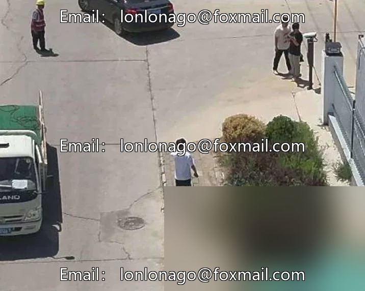
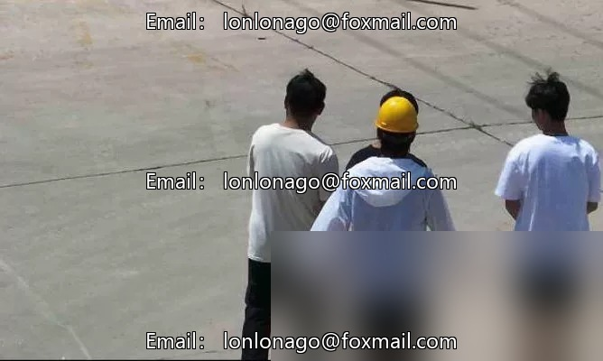
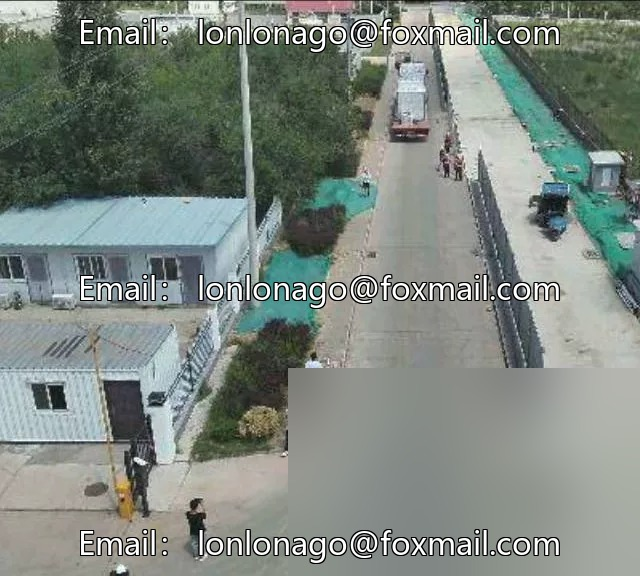
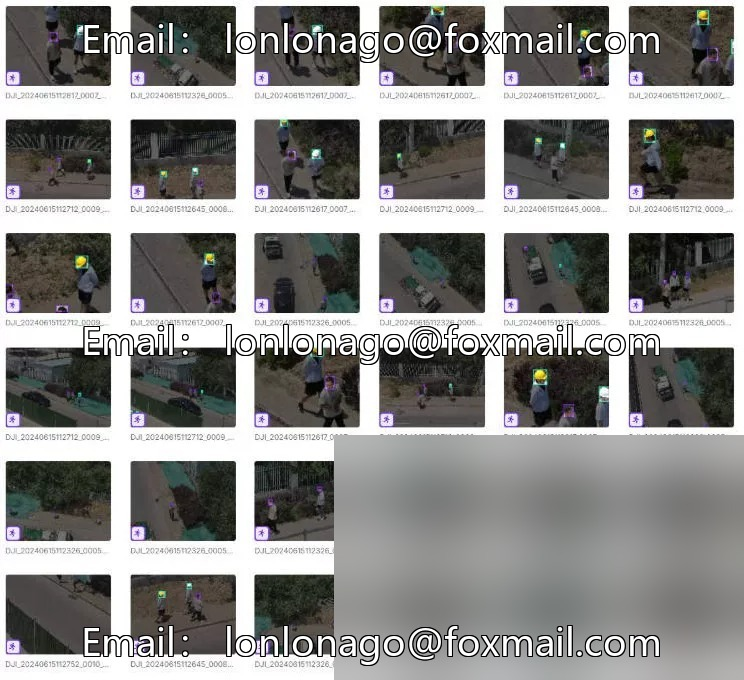

# Drone security hat recognition dataset, YOLO format

## Body

Drone safety hat recognition dataset, YOLO format

A total of 3,227 images, all with labels, divided into training set, test set, and validation set.
Divided into two categories: 'head', 'helmet'; 'head'; 'helmet'.

YOLOv8 weight files (100 training epochs, pretrained model YOLOv8m.pt, mAP 0.778), result files with training;
YOLOv11 weight files (100 training epochs, pretrained model YOLO11m.pt, mAP 0.812), result files with training.

web-based shipment, can be directly photographed and shipped.

The dataset covers UAV safety helmet recognition in YOLO format, with 3,227 labeled images split into training, testing and validation sets; it also includes YOLOv8 and YOLOv11 weight files and their training results.

<!-- AI_ENRICHED -->

## Images

## Payment

Here is a pay link on Stripe ( https://buy.stripe.com/3cs8yP7sY87d0vu9AB ). Please contact me lonlonago@foxmail.com after funding $89, and I will send you a complete data files , thank you!

